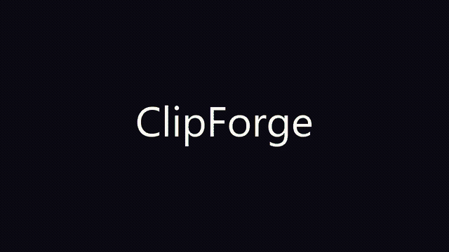
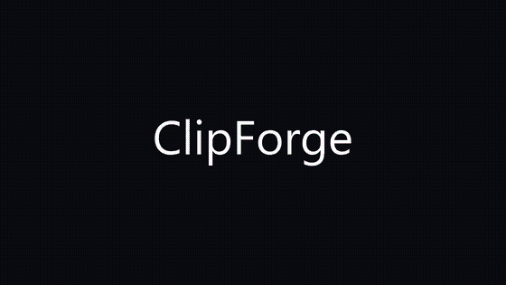

# ClipForge

**ClipForge is a local video compilation and montage maker.** Paste video links, and it downloads clips from 1000+ sites (via yt-dlp) and edits them into stitched or beat-synced montages with FFmpeg, right on your own computer. GPU-accelerated, with a desktop app and a browser capture extension. Nothing is uploaded.

<p align="center">
  
  <br><i>Beat-synced montage built from a set of links, in one click.</i>
</p>

<p align="center">
  <a href="https://github.com/Touka01/ClipForge/releases/latest"><b>Download for Windows</b></a> ·
  <a href="#run--stop--restart">Run from source</a> ·
  <a href="#how-it-works">How it works</a>
</p>


<table>
  <tr>
    <td width="50%"><br><p align="center"><i>Crossfade transitions</i></p></td>
    <td width="50%"><br><p align="center"><i>Ken Burns pan/zoom on images</i></p></td>
  </tr>
</table>

> The clips above are original test patterns generated for the demo. ClipForge works with real video from **1000+ sites** (YouTube, social platforms, direct MP4s, and more) through yt-dlp, and with local files you already have.

## What it does

Three ways to build a compilation:

- **Stitch** downloads every clip, matches their size and frame rate, and joins them in the order you choose.
- **Smart cut** removes silences and dead air from each clip first, then joins them.
- **Montage** makes fast cuts. It can sync to a music track's beats, or to each clip's own audio (the impacts, speech, claps, and breaths) so the cuts land on the action. Either way the original audio is kept.

No timeline, no editor to learn. Paste, pick a mode, forge.

## Features

- Downloads from 1000+ sites through [yt-dlp](https://github.com/yt-dlp/yt-dlp) (YouTube, TikTok, X, Reddit, Vimeo, direct MP4, and more).
- Mixes videos and still images in one compilation. Images get an automatic Ken Burns pan and zoom.
- Output in 16:9, vertical 9:16 for TikTok and Reels, or 1:1 square, with pad or smart center-crop.
- Loudness normalization so clips do not jump in volume.
- Crossfade or fade transitions.
- Reorder clips and set a start/end trim per clip before rendering.
- Warns about duplicate links and lets you keep both or drop the extras.
- Cancel a render at any time. Failed links are listed afterward so you know what to retry.
- Optional browser cookies for login or age-gated videos.
- **GPU-accelerated export** (NVIDIA NVENC, Intel QSV, or AMD AMF) when your machine has it, with a CPU fallback.
- **Use local files** you already have: point it at a folder and add clips without downloading.
- **Per-video quality** and an auto-quality-ladder that steps down resolution if a slow host would otherwise time out.
- **Stream player** (no download): watch your links back-to-back as one continuous, shuffled or in-order playlist.

## Skip the copy and paste

Capturing links by hand gets tedious, so there are two shortcuts:

- A **bookmarklet** you drag to your bookmarks bar. Click it on any page with a video and the link goes straight into ClipForge.
- A **browser extension** that adds a one-click capture button and a right-click menu. The app can launch a browser with it already loaded, or you can install it by hand. See [`extension/`](extension/).

Captured links show up one by one with a live status (queued, downloading, ready, or failed) and download in the background while you keep adding more. When you forge, those downloads are reused, so the render starts almost immediately.

## Install

Requirements:

- Windows (the prebuilt app is Windows only for now)
- For running from source: Python 3.10 or newer

The prebuilt app bundles FFmpeg, so there is nothing else to install. If you run from source, you need FFmpeg on your PATH.

### Prebuilt app

Download the latest `ClipForge-Windows.zip` from the [Releases page](https://github.com/Touka01/ClipForge/releases/latest), unzip it anywhere, and run `ClipForge.exe`.

The app is not code-signed yet, so Windows SmartScreen may show an "unknown publisher" notice the first time. Click "More info" then "Run anyway".

### Run from source

```bash
git clone https://github.com/Touka01/ClipForge.git
cd ClipForge
python -m venv .venv
# Windows: .venv\Scripts\activate    macOS/Linux: source .venv/bin/activate
pip install -r requirements.txt
python app.py
```

On Windows you can also just double-click `run.bat`, which sets up the environment on first run and starts the app after that.

### Two ways to use it

ClipForge runs the same either way, so pick what you prefer:

- **As a desktop app** (default): `run.bat` opens ClipForge in its own window, with its own taskbar icon and no browser tab. The prebuilt `.exe` does this too. This is `desktop.py`.
- **In your browser**: run `python app.py` and open `http://127.0.0.1:8765`. Handy if you would rather not have another window, or want it on a second monitor tab.

If the native window is not available on your system, the app opens in your default browser automatically.

## Run, stop, restart

- Start: `run.bat` (native window), or `python app.py` (browser at `http://127.0.0.1:8765`).
- Stop: click Quit in the app, run `stop.bat`, or close the window.
- Restart: run `run.bat` again.

Idle, the app uses almost no CPU and about 60 to 90 MB of RAM. FFmpeg only runs during a render, and renders run one at a time. You can set an idle auto-shutdown in Settings so the app closes itself after a set number of minutes with nothing to do.

### Where files live

Downloads, exports, temporary files, and settings live in a per-user folder outside the project (`%LOCALAPPDATA%\ClipForge` on Windows). That keeps the checkout clean and means nothing gets synced by OneDrive. You can change the download and export folders in Settings. Set a project name on a render to send its output to its own subfolder.

## How it works

```
links -> yt-dlp (download) -> normalize (FFmpeg) -> stitch / smart cut / montage -> MP4
```

Beat detection and content-onset detection use [librosa](https://librosa.org/). If librosa is missing, montage still works using a fixed grid. Smart cut uses [auto-editor](https://github.com/WyattBlue/auto-editor) when available and falls back to an FFmpeg silence filter otherwise.

## Building the Windows app yourself

```bash
pip install -r requirements-build.txt
pyinstaller clipforge.spec --noconfirm
```

The result is in `dist/ClipForge`. GitHub Actions builds this automatically and attaches the zip to a Release whenever a version tag (like `v0.1.0`) is pushed. See [`.github/workflows/build.yml`](.github/workflows/build.yml).

## Contributing

Issues and pull requests are welcome. See [CONTRIBUTING.md](CONTRIBUTING.md).

## License

MIT. See [LICENSE](LICENSE). ClipForge builds on yt-dlp, FFmpeg, auto-editor, and librosa.

Only download and compile content you have the right to use, and follow each site's terms of service and the copyright law that applies to you.
